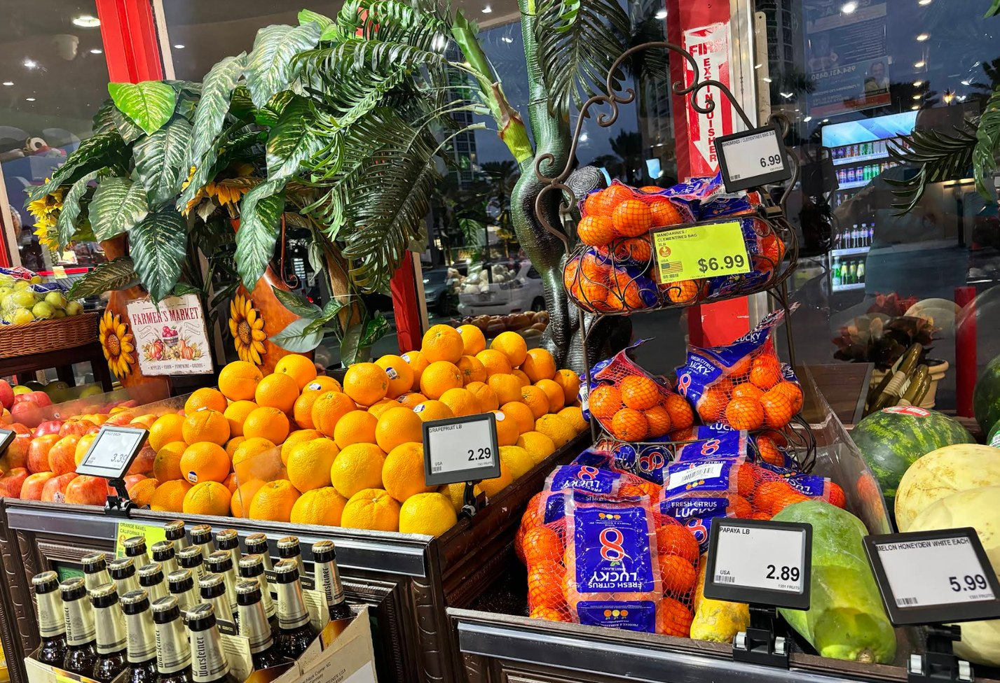
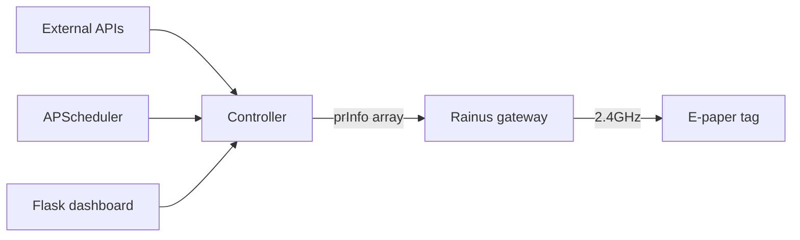

# ESL Hub

Retail electronic shelf labels, repurposed as always-on household dashboards.

Walk down any supermarket aisle and the price tickets on the shelf edge are not
card any more. They are electronic shelf labels: a small e-paper display, a
radio, a coin cell, and a gateway in the back office pushing prices to thousands
of them at once. Retail buys them by the pallet, which makes them cheap on the
second-hand market and very good at the one thing a wall dashboard actually
needs, which is holding a page of information for months without being plugged
into anything.



They are also a nicer object than a tablet. No glow, no notifications, no black
rectangle when it sleeps. A tag that has not changed since this morning looks
exactly like a printed card, because that is what it was designed to imitate.

So this project takes that hardware and points it at something other than the
price of oranges.

A Flask app on a Raspberry Pi pulls from external APIs on a schedule and pushes
rendered payloads to a set of Rainus InforTab e-paper tags. The tags refresh a
few times a day, draw no power between refreshes, need no wires, and stay
readable in daylight.

## What is on the wall


| Dashboard | Pulls from | Layout |
|---|---|---|
| Weather | Open-Meteo, three cities | `4p20c_Weather` |
| Fitness | Strava, monthly activity grid and heart rate | `4p20c_Fitness` |
| Energy | Shelly Cloud, whole-house consumption | `4p20c_Energy` |
| Formula 1 | Jolpica/Ergast, next race weekend and standings | `4p20c_Formula1` |
| Dota 2 | OpenDota, MMR progress | `4p20c_Dota` |
| Mercedes | A scraper on a remote VM, over SCP | `4p20c_WebScraper` |
| Family calendar | Google Calendar, today and what is coming up | `4p20c_SharedCalendar` |

## How it works



A controller fetches data, formats it into a flat array of strings, and POSTs
that array to the gateway along with a tag ID and a layout ID. The gateway
renders the layout against the array and transmits the image to the tag over its
own 2.4GHz radio.

Nothing about the visual design lives in this repository. Layouts are built in
the vendor's Layout Designer, and a controller only decides what goes into each
slot.

## Hardware

- Raspberry Pi 3 Model B, Debian 12
- Rainus InforTab all-in-one gateway, which is both gateway and server
- InforTab R420 tags: 4.20 inch, 400 x 300 px, roughly 120 dpi, three inks only
  (black, white, red)

## Anatomy of a controller

Every controller exposes a single entry point and reads everything it needs from
the config it is handed. Nothing is hardcoded.

```python
from gateway import publish

def run(full_config):
    sys_cfg = full_config["system"]      # gateway_ip, store_code
    cfg = full_config["your_section"]    # tag_id, credentials, schedule

    pr_data = [""] * 250                 # index N maps to PR_N in the layout
    pr_data[150] = "27"
    pr_data[151] = "september"

    publish(sys_cfg, {
        "storeCode": sys_cfg["store_code"],
        "product": [{
            "prCode": cfg["tag_id"],
            "layoutId": "4p20c_YourLayout",
            "prInfo": pr_data,
            "nfc": "",                   # omitting this returns a 500
        }],
    })
```

Register it in `job_worker.py`, `app.py`'s `JOB_NAMES` and job lock map. Add a
settings tab in `templates/index.html`, config defaults, and a matching
`process_tab` call if it needs one. Raise an exception when fetching or
publishing fails; raise `JobSkipped` for a valid response with nothing to show.

The array must be at least as long as the highest index you write. Controllers
here range from 100 to 300 entries.

## Setup

```bash
git clone git@github.com:desigrit/esl-home-hub.git
cd esl-home-hub
python3 -m venv .venv
. .venv/bin/activate
python -m pip install -r requirements.txt
cp config.example.json config.json   # then fill in your own values
python app.py                        # dashboard on :5000
```

Python 3.9 or newer, for `zoneinfo`. `PyJWT` needs the `crypto` extra because the
calendar controller signs its service account assertion with RS256.

### Microsoft To Do access

RonHub includes a read-only **To Do** dashboard tab and a JSON endpoint at
`/api/todo`. The `/todo` route opens the dashboard with that tab selected. Both
use the Microsoft Graph To Do API and the delegated `Tasks.Read` permission.
The same data service powers an optional `4p20c_Todo` shelf-label controller.
Its schedule, tag ID, layout ID, manual trigger, and execution logs are managed
from the To Do tab. The controller stays disabled until a tag ID is supplied.

1. Register an application in the Microsoft Entra admin center. For a personal
   account, choose **Personal Microsoft accounts only**.
2. Add the delegated Microsoft Graph permission `Tasks.Read`.
3. In **Authentication > Advanced settings**, enable **Allow public client
   flows**. Do not create a client secret.
4. Add the Application client ID to the `todo` section of `config.json`.
5. Install MSAL and run the device-code sign-in as the same Linux user that runs
   the service:

```bash
sudo apt-get install python3-msal
cd /home/ronhub/esl_hub
python3 todo_auth.py
sudo systemctl restart esl_hub
```

Open the URL printed by the command on any phone or computer, enter the code,
and sign in to the Microsoft account that owns the tasks. The token cache is
stored at `controllers/data/microsoft_todo_token_cache.json` with owner-only
permissions and is ignored by git.

The JSON endpoint follows every Microsoft Graph pagination link for both lists
and tasks. It requires the `todo.api_key` value from `config.json` in an
`X-API-Key` header and returns only the task fields used by RonHub. Notes and
linked resources are not fetched or returned. The browser page calls the
service internally and does not expose the key. Devices that can reach RonHub
can view the browser page, so keep port 5000 on a trusted network or put an
authenticated reverse proxy in front of it.

### Microsoft To Do label contract

The controller always sends a 250-entry `prInfo` array. The layout can choose
between a compact list overview, a cross-list task queue, and a focused-list
view without changing the Graph integration.

| Registers | Content |
|---|---|
| `PR_150` to `PR_159` | Date, update time, totals, density state, and overflow |
| `PR_160` to `PR_191` | Eight list rows: name, active count, first task, and tone |
| `PR_192` to `PR_199` | Focused-list metadata, due counts, and empty state |
| `PR_200` to `PR_223` | Six prioritized tasks from all lists |
| `PR_224` to `PR_247` | Six tasks from the focused list |
| `PR_248` to `PR_249` | Contract version and display mode |

Task and list names are sent only to the Rainus gateway. Controller logs retain
counts, not task content.

Run it under systemd in production. If dependencies are installed in the
virtual environment above, set `ExecStart` to the full path of
`.venv/bin/python`. The existing Raspberry Pi deployment instead uses Debian's
system packages and `/usr/bin/python3`. In either case, the unit runs `app.py`
as a normal user with `Restart=always`.

**Restart the service after editing any `.py`**, otherwise manual triggers in
the dashboard keep running the old code.

```bash
sudo systemctl restart esl_hub
```

### Google Calendar access

The family calendar controller authenticates as a Google Cloud **service
account**, which avoids a browser consent step and a refresh token that expires
on a headless device.

1. Create a project, enable the Google Calendar API, create a service account
   and download a JSON key.
2. Put the key at `controllers/data/google_service_account.json`.
3. Share each calendar with the service account's email address, with
   "See all event details".
4. Take the calendar ID from Settings and sharing, under Integrate calendar, and
   put it in `calendar_ids`.

Sharing a calendar with a service account grants access but never adds it to
that account's own calendar list, so `--list-calendars` will look empty. That is
expected. Address calendars by ID.

```bash
python3 controllers/family_controller.py --check <calendar_id>
python3 controllers/family_controller.py --dry-run
```

### Calendar title overflow

The controller limits today's and upcoming event titles to 29 characters,
using `haircut at Kim Studio @ 4:30p` as the baseline. Longer titles use up to
27 characters followed by `..`. A recurring event's `(R)` prefix counts toward
the same limit. Titles are shortened only in the tag payload; the full titles
in Google Calendar remain unchanged. This is a character budget, not a pixel
measurement, so the existing layout still controls font rendering.

## Configuration

`config.json` holds credentials and is deliberately untracked. Every controller
gets a section:

```json
{
  "system": { "gateway_ip": "...", "store_code": "..." },
  "family": {
    "enabled": true,
    "tag_id": "...",
    "service_account_file": "controllers/data/google_service_account.json",
    "calendar_ids": ["..."],
    "timezone": "America/Los_Angeles",
    "upcoming_days": 120,
    "mode": "schedule",
    "times": ["06:00"],
    "days": 1
  }
}
```

`mode` is either `interval`, using `interval` in minutes, or `schedule`, using
`times` and a `days` gap.

It is strict JSON. A trailing comma stops the app from starting.

## Repository layout

```
app.py                  Flask app, scheduler, routes
controllers/            one module per data source
templates/index.html    dashboard
static/                 vendored bootstrap
```

Not in the repository, by design: `config.json`, `logs.json`, run logs,
`controllers/data/` (API keys and runtime state), and the layouts themselves.

## Notes

- The gateway sits on its own network segment behind the Pi and is not routable
  from the LAN. The Pi proxies its web UI.
- Strava can rotate its refresh token. Updates use a locked, atomic write to
  preserve other settings. Blank password fields keep the saved credentials.
- Mercedes runs through the same scheduler, worker, and dashboard as the other
  integrations. Remove the old `mercedes_controller.py` cron entry when upgrading
  an installation that still uses it, after backing up the crontab.

## Run reliability and diagnosis

Each run gets an isolated process and a five-minute deadline. Overlapping runs
of the same integration are suppressed. Config and logs use locked, atomic
writes. Calendar schedules retain their local clock time through daylight
saving changes; multi-day anchors survive restarts and configuration saves.

The gateway assigns task IDs with `taskId: -1` and `priorTaskId: -1`. Reusing
whole-second timestamps across controllers causes the gateway to reject later
updates as duplicates. `gateway.publish` checks the response body and then
polls the returned task until the gateway confirms delivery to the tags.

- **Success:** the gateway confirmed tag delivery.
- **Failed:** a data fetch, validation, or delivery failed.
- **Pending:** the gateway accepted the update but did not confirm delivery
  within the deadline. Inspect the task ID in the run output before retrying.
- **Skipped:** no applicable data was available, or another run was active.
- **Unverified:** a historical success recorded before delivery checks existed.
  Those old logs may contain output from multiple simultaneous jobs.

`/healthz` checks the app, scheduler, config, and run history. `/api/status`
provides current runs, next scheduled updates, and recent outcomes. The dashboard
refreshes these without reloading unsaved settings. These endpoints are intended
for the same trusted network as the management page.

`system.job_timeout_seconds` can override the worker deadline (30 to 900 seconds).
`system.gateway_confirmation_seconds` controls the delivery wait (1 to 120
seconds, default 45). The sample service in `deploy/esl_hub.service` waits for
network startup, uses private file permissions, and restarts with a delay.

Failed upstream requests preserve the previous display. An inactive Strava app
requires action in the owner's [Strava API settings](https://www.strava.com/settings/api).
The Mercedes source must answer SSH and provide recent data. Neither condition
can be repaired by repeatedly submitting a tag update.

Dota MMR is an estimate using the configured baseline and +/-25 per ranked match.
The controller paginates through the baseline and the 30-day statistics window,
instead of limiting the calculation to the latest 100 matches. Shelly uses
separate daily and longer-range requests so the graph stays daily and YTD totals
include earlier months without today's incomplete consumption.

Run the regression suite before deploying:

```bash
python3 -m unittest discover -s tests -q
sudo systemctl restart esl_hub
curl --fail http://localhost:5000/healthz
```
